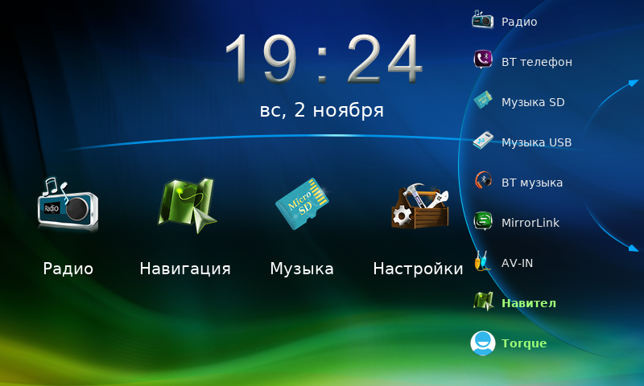

# 19. Как выглядит главный экран

> Скриншота с самой магнитолы у меня быть не может — устройство у вас.
> Макет ниже собран из **настоящих ресурсов оболочки**
> `EL830LF01_Home.apk`: фон, светящиеся цифры часов, иконки кнопок —
> всё файлы из прошивки. Координаты взяты из `res/layout/home.xml` и
> `res/values/dimens.xml`.



## Что здесь что

| Элемент | Источник в оболочке |
|---|---|
| Фон | `drawable/window_bg_full.png`, 800×480 |
| Часы | `main_ico_clock_0…9`, `main_ico_clock_colon` (48×70 каждая) |
| Разделитель | `mainmenu_bg.png`, 682×30 |
| Иконки кнопок | `main_btn_*_normal.png`, 140×140 |
| Правая панель | `main_bg_circle_list.png`, 235×445, прижата к правому краю |

## Что показываю приблизительно

Сам я макет в магнитоле не видел, поэтому две вещи на картинке —
**реконструкция, а не факт**:

1. **Правая панель.** В оболочке это `CircleListView` — круговая карусель,
   а не простой список. Раскрывается кнопкой-стрелкой у правого края
   (`btn_show_clapps`, координаты 750×183). Я изобразил её списком, чтобы
   было видно состав. На устройстве иконки идут по дуге и прокручиваются.
2. **Избранные иконки.** В оболочке это `FavoriteBtn` — контейнеры,
   содержимое которых подставляется в рантайме. Я показал те, что
   логичны: Радио, Навигация, Музыка, Настройки.

## Что добавлено нашим патчем

Две последние подписи, выделенные зелёным:

- **Навител** — `com.navitel` был в списке `initDefault_EL830CLF01()`
  изначально, но кнопка появлялась только при установленном пакете.
  Теперь APK лежит в `/priv-app`, кнопка будет.
- **Torque** — `org.prowl.torque` добавлен нашим патчем в список экрана,
  плюс в ветку по умолчанию вписан `setActivity`, иначе нажатие ничего
  не делает.

Без патча список заканчивался на AV-IN.

## Где искать в файлах

```
docs/mockup/главный-экран-макет.png   итоговая картинка
docs/mockup/parts/                    фон, цифры часов, панель
docs/mockup/btns/                     иконки кнопок из APK
docs/mockup/home.xml                  оригинальный layout (apktool)
tools/make_mockup.py                  скрипт сборки макета
```

Пересобрать макет: `python3 tools/make_mockup.py` (нужен Pillow).

## Часы и часовой пояс

В заводском `build.prop` часового пояса **нет вообще**:

```
ro.product.locale.language=zh
ro.product.locale.region=CN
```

Поэтому магнитола показывала время по Гринвичу (UTC) — Москва отставала
на 3 часа. Настройка через меню не помогала: она живёт в `/data`, а этот
раздел форматируется при каждой прошивке (`format_operation` в скрипте
обновления делает `mke2fs` для p2, p3, p5, p6).

Теперь сборка добавляет в `/build.prop`:

```
persist.sys.timezone=Europe/Moscow
```

Это свойство читает `TimeZoneGetter` при старте системы, до запуска
приложений, и оно не сбрасывается перепрошивкой, потому что лежит в
системном разделе.

Задать другой пояс можно в `build-full.yml`:

```yaml
--set-prop persist.sys.timezone=Asia/Yekaterinburg
```

Список допустимых имён — стандартные зоны IANA (`Europe/Moscow`,
`Asia/Novosibirsk`, `Asia/Vladivostok` и т.д.).

Проверка в отчёте сборки:

```
часовой пояс:
persist.sys.timezone=Europe/Moscow
```
